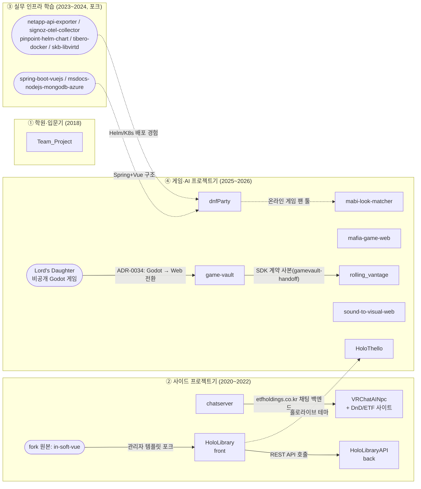

# kalraid GitHub 저장소 분석

> 작성일: 2026-11-09 · 대상: `github.com/kalraid`의 **공개 저장소 21개**(직접 만든 저장소 13개 + 포크 8개)
> private 저장소는 조회 권한 없이 분석해서 빠져 있습니다. 본문에 이름만 나오는 비공개 프로젝트(예: Godot판 *Lord's Daughter*)는 다른 저장소 문서에 적힌 내용으로만 짐작했습니다.

---

## 1. 한눈에 보기

| 시기 | 저장소 | 한 줄 요약 | 주요 스택 | 커밋 |
|---|---|---|---|---|
| 2018 | [Team_Project](#team_project) | 학원 시절 팀 프로젝트 모음 (의약품/건강 정보 사이트) | Java, Spring MVC, JSP | 151 |
| 2020 | [VRChatAINpc](#vrchatainpc) | VRChat을 AI가 플레이하게 만드는 MSA 실험 + ETF 사이트(DnD) | Spring Boot, Flask/Django, RabbitMQ, Vue 2 | 201 |
| 2021 | [chatserver](#chatserver) | socket.io 채팅 서버 (DnD/ETF 사이트용) | Node.js, Express, socket.io | 37 |
| 2021 | [kalraid](#kalraid) | GitHub 프로필 README | Markdown | 2 |
| 2021 | [HoloLibrary](#hololibrary--hololibraryapi) | 홀로라이브 트위터/유튜브 라이브러리 **프론트엔드** (포크 기반) | Vue 2, Vuetify | 174 |
| 2021 | [HoloLibraryAPI](#hololibrary--hololibraryapi) | 위 서비스의 **백엔드** + 트위터 크롤링 배치 | Python, Falcon, PostgreSQL | 80 |
| 2025 | [HoloThello](#holothello) | 오셀로 + 격투 HP 대전 캐주얼 게임 | Unity (C#) | 16 |
| 2025 | [dnfParty](#dnfparty) | 던전앤파이터 레이드 파티 관리·최적화 서비스 | Spring Boot 3, Vue 3, MariaDB, Helm/K8s | 53 |
| 2026 | [mafia-game-web](#mafia-game-web) | AI 플레이어와 하는 웹 마피아 게임 (AI 부트캠프 최종 과제) | FastAPI, LangGraph, Claude API, Streamlit, Redis, ChromaDB | 94 |
| 2026 | [mabi-look-matcher](#mabi-look-matcher) | 참고 사진을 넣으면 마비노기 의상 후보를 찾아 입혀 보는 서비스 | FastAPI, Next.js, Gemini/CLIP | 6 |
| 2026 | [sound-to-visual-web](#sound-to-visual-web) | MIDI/MusicXML을 3D 지형+큐브로 시각화 | FastAPI, music21, Three.js, Tone.js | 39 |
| 2026 | [game-vault](#game-vault) | 브라우저 게임용 포털 (인증·세이브·실시간 SDK) | Vite+React, Express, Prisma, SQLite | 16 |
| 2026 | [rolling_vantage](#rolling_vantage) | 그리드 소환 전술 + 주사위 판정을 섞은 웹 게임 (설계 단계) | TypeScript (설계 문서 위주) | 14 |
| 2026 | private_wiki | 이 위키 | Markdown | – |

---

## 2. 관계도

### 관계를 정리하면

1. **같은 서비스를 이루는 저장소**
   - `HoloLibrary`(Vue 프론트) ↔ `HoloLibraryAPI`(Python 백엔드): 하나의 "홀로라이브 트위터/유튜브 라이브러리" 서비스를 프론트와 백엔드로 나눈 것입니다. 프론트는 회사 사내 템플릿 `kimyearho/in-soft-vue`를 포크해서 시작했습니다.
   - `chatserver` ↔ `VRChatAINpc/DnD`: chatserver의 CORS 허용 도메인이 `etfholdings.co.kr`인데, 이 사이트가 VRChatAINpc 저장소 안의 `DnDPartes`(Spring Boot, `fund/etf` 패키지)와 `dnd-project`(Vue 2)입니다. **chatserver는 이 ETF 사이트의 실시간 채팅 서버**입니다.
2. **플랫폼과 그 위에 올라갈 게임**
   - `game-vault`는 게임 로직 없이 인증·세이브·계정 데이터·실시간 이벤트만 `postMessage` SDK로 제공하는 **포털**입니다.
   - `rolling_vantage/gamevault-handoff/`에는 game-vault의 `GAME_MODULE.md`·`shared/` SDK 타입·`sample-game`이 그대로 복사돼 있습니다. **rolling_vantage는 game-vault에 붙일 첫 외부 게임 모듈 후보**입니다.
   - game-vault의 `0034-godot-to-web-pivot.md`를 보면, 비공개 Godot 4 게임 *Lord's Daughter*를 웹으로 옮기면서 서버 저장소가 필요해졌고, 그 결과물이 game-vault입니다. 포털의 기본 등록 게임 ID도 `lords-daughter`입니다.
3. **주제가 이어지는 저장소**
   - 서브컬처/홀로라이브: `HoloLibrary(API)` → `HoloThello`(홀로라이브풍 캐릭터 오셀로).
   - 넥슨 온라인 게임 팬 툴: `dnfParty`(던파) → `mabi-look-matcher`(마비노기).
   - AI 활용: `VRChatAINpc`(2020, 직접 짠 NLP/MSA 구상) → `mafia-game-web`(2026, LLM 에이전트 + RAG).
4. **포크 저장소는 업무와 학습용 참고 자료**: 모니터링(NetApp exporter, SigNoz OTel, Pinpoint Helm), DB/가상화(Tibero Docker, libvirtd), 아키텍처 예제(Spring Boot+Vue, Azure Node+Mongo). 2025년 dnfParty의 Helm 차트 기반 K8s 배포에 이 경험이 쓰인 것으로 보입니다.

---

## 3. 저장소별 상세

### Team_Project
- **기간**: 2018-08 ~ (README 갱신 2024-07)
- **설명**: "최초 프로그래밍 학습을 위해 학원에 다니면서 했던 프로젝트".
  - `medicine_inc/`: Spring MVC + MyBatis + JSP(Eclipse/Maven). 질병·음식·건강지원 게시판, 카카오/네이버 소셜 로그인. 팀원별 패키지(`chanho`, `aehee`, `Changmyoung` …)로 역할을 나눴습니다. 본인 담당은 `chanho` 패키지(음식·질병 DAO/Service)입니다.
  - `PlayGroundProject/`: 서블릿/JSP 기반 웹 프로젝트(`WebContent`).
- **의미**: 개발 커리어의 출발점입니다.

### VRChatAINpc
- **기간**: 2020-03 ~ 2021-02 (커밋 201개로 가장 많음)
- **목표**: AI가 VRChat에 접속해 대화(한/영/일/중 번역, 문장 분석, 화제 제시)하고 행동(이동·손짓·표정)까지 하게 만들기.
- **설계**: 신체 기관을 본뜬 마이크로서비스 구조입니다.
  - `VRChatAINpcMain`(Spring Boot 메인/관제), `Body`, `Camera`, `Heart`, `Keyboard`, `Mic`, `Speaker` 모듈
  - Java(Spring Boot) ↔ RabbitMQ ↔ Python(Flask/Django) 언어·청각 서버, 서버마다 MariaDB
- **곁가지**: 같은 저장소에 `DnDPartes`(Spring Boot + JWT, ETF/펀드 API, IEX 주가 API)와 `dnd-project`(Vue 2 + Vuetify, GCP App Engine 배포)가 함께 있습니다. 마지막 커밋은 "iex api"입니다. **결국 AI NPC보다 ETF 정보 사이트(etfholdings.co.kr) 쪽이 더 진행된 것으로 보입니다.**

### chatserver
- **기간**: 2021-03 ~ 2021-09
- **설명**: "학원 프로젝트 - chatting server (websocket 학습용)". Express + socket.io 단일 `app.js`. 사용자 목록과 메시지 기록을 메모리에 두는 단순 채팅 서버입니다.
- **배포 메모**(`server.md`): GCP Compute/App Engine 방화벽 설정, Oracle Cloud VM, pm2 사용법.
- **관계**: 허용 Origin이 `etfholdings.co.kr`이므로 VRChatAINpc 안의 DnD ETF 사이트용 채팅 서버입니다.

### kalraid
- GitHub 프로필용 특수 저장소입니다. 기본 템플릿 상태이고 블로그 제작 참고 링크가 하나 있습니다.

### HoloLibrary / HoloLibraryAPI
- **기간**: 2021-06 ~ 2022-10
- **서비스 목표**: 홀로라이브 버튜버의 유튜브·트위터 활동을 "라이브러리"로 모으고, 팬아트 트윗 크롤링·태그 통계·키리누키(클립) 기능을 제공합니다.
- **HoloLibrary (프론트, 포크)**: 원본은 `kimyearho/in-soft-vue`(Insoft 사내 Vue 관리자 템플릿 v0.2)입니다. Vue 2 + Vuetify에 `api/tweet.js`, `twitter.js`, `statistics.js`, `member.js` 등 서비스 API 모듈을 추가했습니다.
- **HoloLibraryAPI (백엔드)**: Python Falcon REST API + PostgreSQL. 기반은 `ziwon/falcon-rest-api` 보일러플레이트입니다.
  - `api/v1`: auth, member, menu, statistics(image/youtube), twitter, kirinuki, board
  - `batch/`: 스레드 기반 트위터 크롤러(일반/태그/커스텀 태그)
  - 마지막 커밋: "DB 비동기 처리 작업 진행중", 이후 중단됨
- **관계**: 프론트와 백엔드로 짝을 이루는 한 서비스입니다.

### HoloThello
- **기간**: 2025-07 ~ 2025-09 · Unity 2022.3 (C#)
- **설명**: 오셀로로 상대 HP(10000)를 깎는 "홀로 격투 오셀로". 캐릭터 20종(홀로라이브풍 10, 고양이 10), 스킬 3종, 1P vs CPU / 1P vs 2P / CPU vs CPU 모드, 주사위로 선공 결정.
- **상태**: 문서상 진행률 99%. 남은 일은 Unity 에디터에서 UI를 연결하는 작업입니다. `Docs/`에 프리팹별 설계 문서가 정리돼 있습니다.

### dnfParty
- **기간**: 2025-08 ~ 2025-09
- **설명**: 던전앤파이터(DFO) 모험단의 레이드 파티 관리 서비스입니다.
  - Neople 공식 API + Playwright로 던담 스탯 크롤링
  - 던전별(나벨·베누스·안개신·황혼전) 주간 클리어 현황, 매주 목요일 자동 초기화
  - 8인 파티 자동 구성·최적화·공유, SSE 실시간 동기화
- **스택**: Spring Boot 3.2 / Java 17 / JPA / MariaDB + Vue 3 / Vite 7.
- **배포**: Docker + Helm 차트(앱/인프라 분리) + Nginx Ingress(HTTPS), PowerShell 배포 스크립트. 개인 프로젝트 중 운영 수준에 가장 가깝습니다.

### mafia-game-web
- **기간**: 2026-03 ~ 2026-04 (커밋 94개)
- **설명**: **AI Bootcamp 최종 과제**입니다. 최대 20인 웹 마피아 게임이며, 빈자리는 LLM 에이전트가 채웁니다.
- **스택**: FastAPI + LangGraph/LangChain, Claude API 또는 Azure OpenAI(환경변수로 전환, 키가 없으면 랜덤 Fallback), ChromaDB RAG로 전략 학습, Redis + LangGraph Checkpointer로 세션 관리, WebSocket 푸시, Streamlit 프론트, docker-compose.
- **특징**: `CLAUDE.md`에 서브에이전트 모델 배정 규칙(haiku/sonnet/opus)을 적어 두는 등 AI 코딩 에이전트를 본격적으로 쓰기 시작한 프로젝트입니다.

### mabi-look-matcher
- **기간**: 2026-05
- **설명**: 참고 사진을 올리면 마비노기 장비 슬롯별로 비슷한 아이템 후보 10개 정도를 보여 주고, 기존 캐릭터 시뮬레이터(Sigkill) 위에 입혀서 2D/3D로 미리 볼 수 있게 합니다.
- **스택**: Python 3.11 패키지(`packages/look_matcher`: analysis, vision, catalog_store, candidate_builder, embedding_rank) + FastAPI + Next.js. Gemini Vision / CLIP / Redis를 쓰지만, mock 모드에서는 셋 다 없이 동작합니다.
- **문서화**: `CONTEXT.md`(도메인 용어집) + ADR 13개 + PRD + 이슈 백로그.

### sound-to-visual-web
- **기간**: 2026-06
- **설명**: MIDI/MusicXML을 분석해 **캐논 / 화성 / 기타**로 분류합니다. 화면 위쪽에는 다성부 악보를 띄우고, 아래쪽에서는 성부별 음높이를 3D 지형(리본)으로 그려 큐브가 미끄러지며 진행합니다. NHK 「명곡앨범+」의 파헬벨 캐논 시각화에서 영감을 받았습니다.
- **스택**: FastAPI + music21 / Vite + Three.js + OpenSheetMusicDisplay + Tone.js.
- **문서화**: ADR 16개(가장 많음), `CONTEXT.md`에 음악 도메인 용어(성부·섬·공유 지형 등) 정리.

### game-vault
- **기간**: 2026-07
- **설명**: 외부에서 만든 브라우저 게임을 iframe/새 창으로 띄우고 `postMessage` SDK(`auth.getToken`, `save.load/store`, `account.get/set`, `realtime.subscribe/emit`)를 중개하는 포털입니다. 게임 로직은 갖지 않습니다.
- **스택**: Vite + React, Express, Auth.js, Prisma + SQLite, Docker, Playwright e2e, Vitest.
- **결정 기록**: ADR-0001(포털 범위와 SDK 계약), ADR-0002(게스트 세션, 로그인하면 정식 계정으로 승격), ADR-0034(Godot → Web 전환, *Lord's Daughter* 저장소에서 넘겨받은 문서).

### rolling_vantage
- **기간**: 2026-07
- **설명**: *Vantage Master V2*의 그리드 소환사 전술과 *Dice of Afterimage*의 주사위 판정을 **하나의 전투 레이어로 합친** 웹 게임 설계입니다. 플레이어 + CPU 경쟁자 7 + 야생 세력이 영토를 두고 경쟁하는 로그라이트 구조(Run / Meta GP / Master 로스터 12~16명)이고, 챕터마다 시나리오 테마 규칙 변형 9종이 있습니다.
- **상태**: 아직 코드보다 `CONTEXT.md` + ADR 3개 + `GRILL_TODO.md` 같은 설계 문서가 중심입니다.
- **관계**: `gamevault-handoff/`에 game-vault SDK 계약이 복사돼 있으므로 **game-vault 위에서 돌아갈 게임 모듈**로 계획된 것입니다.

---

## 4. 포크 저장소 (참고/업무용)

| 저장소 | 원본 | 용도 추정 |
|---|---|---|
| HoloLibrary | kimyearho/in-soft-vue | HoloLibrary 프론트의 베이스 (위 참고) |
| netapp-api-exporter | sapcc/netapp-api-exporter | NetApp ONTAP Prometheus 익스포터 (스토리지 모니터링) |
| signoz-otel-collector | SigNoz/signoz-otel-collector | OpenTelemetry 기반 APM/관측성 |
| pinpoint-helm-chart | dyingtime/pinpoint-kubernetes | Pinpoint APM을 K8s에 Helm으로 배포 |
| tibero-docker | h-wookie/tibero-docker | Tibero 6 DB 컨테이너화 |
| skb-libvirtd | skbroadband/skb-libvirtd | libvirt 가상화 데몬 |
| spring-boot-vuejs | jonashackt/spring-boot-vuejs | Spring Boot + Vue 통합 예제 |
| msdocs-nodejs-mongodb-azure-sample-app | Azure-Samples/… | Azure App Service + Cosmos DB 예제 |

2023~2024년 포크는 대부분 **모니터링/APM, K8s, 국산 DB, 가상화**입니다. 이 시기에는 인프라·운영(SRE) 쪽 업무를 한 것으로 보입니다.

---

## 5. 흐름과 패턴

1. **입문 (2018)**: 학원 팀 프로젝트로 Java/Spring MVC/JSP를 익혔습니다.
2. **사이드 프로젝트 (2020~2022)**: MSA·메시지큐(VRChatAINpc), 실시간 통신(chatserver), 크롤링+통계 서비스(HoloLibrary)처럼 의욕적인 구조를 시도했습니다. 다만 대부분 완성 전에 중단됐습니다.
3. **인프라 공백기 (2023~2024)**: 개인 프로젝트 대신 업무 관련 포크(모니터링, K8s)가 늘었습니다.
4. **AI 코딩 에이전트 시대 (2025~2026)**: 프로젝트 수와 완성도가 함께 올랐습니다.
   - 2025년: 게임(HoloThello)과 게임 팬 툴(dnfParty)을 실제 배포 수준까지 만들었습니다.
   - 2026년: **`CONTEXT.md`(도메인 용어집) + `docs/adr/`(결정 기록) + TODO** 형식이 mabi-look-matcher, sound-to-visual-web, game-vault, rolling_vantage에서 똑같이 반복됩니다. 설계를 문서로 먼저 굳힌 뒤 구현하는 방식이 자리 잡았습니다.
   - 기술 스택도 Java/Spring 중심에서 **Python(FastAPI) + TypeScript(Vite/React/Next/Three.js)** 중심으로 옮겨 갔습니다.
5. **반복되는 관심사**: 게임(직접 만들기 + 기존 게임 보조 툴), 서브컬처(홀로라이브), AI(NPC → LLM 에이전트), 시각화(통계 차트 → 3D 음악 시각화).
